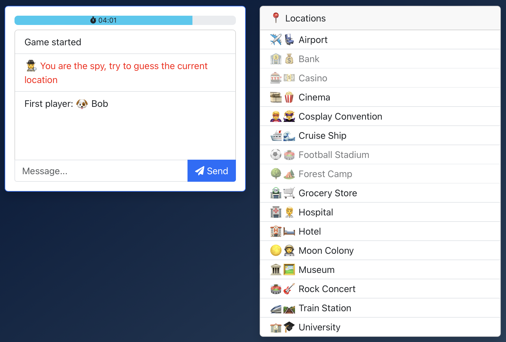

# 🕵️ Spyfall - Server

[](./LICENSE.txt)
[](https://github.com/VeryBadFrags/spyfall-server/actions/workflows/docker-publish.yml)
[](https://github.com/VeryBadFrags/spyfall-server/tags)

A multiplayer social deduction game inspired by
[Spyfall](https://hwint.ru/portfolio-item/spyfall/).

[♟️ Play the game](https://spyfall.verybadfrags.com)

<details>
    <summary>🖥️ Game screenshot</summary>
    
</details>

## Stack

🛠️ Built with [Node](https://nodejs.org),
[Typescript](https://www.typescriptlang.org), and
[socket.io](https://socket.io).

- [💾 View the client source code](https://github.com/VeryBadFrags/spyfall-client)

## Run locally

### With [mise](https://mise.jdx.dev)

```sh
mise install # only required once
mise dev
```

### With [Node](https://nodejs.org)

```sh
make dev
```

### With [Docker](https://www.docker.com)

```sh
make docker-dev
```
